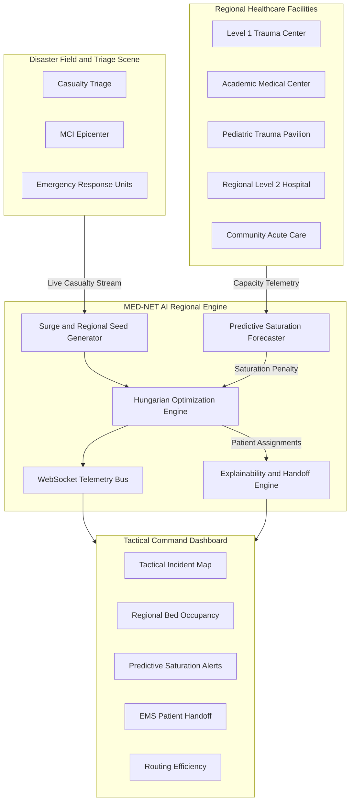

# MED-NET AI: Dynamic Disaster Casualty Routing & Regional Hospital Load-Balancing AI Platform

[](https://github.com/)
[](https://scipy.org/)
[](https://hl7.org/fhir/)
[](LICENSE)

---

## 👥 Team

**Built by a team of B.Tech Computer Science and Engineering (Data Science) students from Mar Athanasius College of Engineering, Kothamangalam, Kerala.**

| Team Member | Institution | Program |
|---|---|---|
| **Rohith B** | Mar Athanasius College of Engineering | B.Tech CSE — Data Science |
| **Isaac Mathew** | Mar Athanasius College of Engineering | B.Tech CSE — Data Science |
| **Liba M** | Mar Athanasius College of Engineering | B.Tech CSE — Data Science |
| **Neha Maria Pullat** | Mar Athanasius College of Engineering | B.Tech CSE — Data Science |
| **Arjun C** | Mar Athanasius College of Engineering | B.Tech CSE — Data Science |

> **MED-NET AI was collaboratively designed and developed by all five team members as a unified hackathon project.**

---

## 🚨 Executive Summary

During a **Mass Casualty Incident (MCI)** or regional disaster, standard emergency logistics can become overwhelmed because emergency response units often transport casualties to the nearest available hospital.

This can create a **secondary collapse**: the nearest facility becomes overloaded while other hospitals in the region may still have available trauma bays, surgical specialists, ICU capacity, ventilators, and blood inventory.

**MED-NET AI** is a resilient emergency-response command platform designed to dynamically balance casualty routing across an entire regional healthcare network.

Instead of relying only on nearest-hospital routing, MED-NET AI models casualty-to-hospital assignment as a **multi-variable global optimization problem** using the **Hungarian Algorithm** through:

```text
scipy.optimize.linear_sum_assignment
```

The system considers:

1. **Patient Acuity** — START triage categories: RED, YELLOW, GREEN, BLACK
2. **Specialized Surgical Coverage** — Trauma, Neurosurgery, Cardiothoracic, Burn Care, Pediatric Surgery
3. **Critical Resources** — Ventilators, CT scanners, ECMO, O-negative blood
4. **ICU and General Bed Capacity**
5. **Predictive Hospital Saturation**
6. **Travel Distance and Transit Time**
7. **Regional Load Balancing**
8. **Explainable AI for Routing Decisions**

---

# 🏛 System Architecture



---

# ⚙️ How MED-NET AI Works

### 1. Casualty Generation

The system simulates a disaster event producing multiple casualties around an incident epicenter.

Each casualty receives:

- Geographic location
- START triage category
- Required medical resources
- Required specialty
- Estimated transport requirements
- Unique patient identifier

### 2. Regional Hospital Modeling

Each hospital maintains dynamic operational information such as:

- Available beds
- ICU capacity
- Trauma capacity
- Surgical specialists
- Ventilator availability
- CT scanner availability
- ECMO availability
- Blood inventory
- Current occupancy
- Predicted saturation time

### 3. Predictive Saturation

MED-NET AI continuously evaluates hospital capacity.

Instead of asking only:

> "Which hospital is closest?"

the system also asks:

> "Will sending this patient here cause the hospital to become dangerously overloaded?"

Hospitals approaching capacity receive an increased routing penalty.

This allows the optimization engine to distribute patients across the regional network.

### 4. Global Patient-Hospital Optimization

MED-NET AI converts hospital capacity into individual assignment slots and constructs a cost matrix between patients and possible destinations.

The Hungarian Algorithm then finds a globally optimized assignment.

```text
Patients
   ↓
Cost Matrix
   ↓
Hungarian Algorithm
   ↓
Optimal Patient → Hospital Assignments
   ↓
Explainability Engine
   ↓
EMS Handoff + Command Dashboard
```

---

# 🧮 Mathematical Optimization Engine

MED-NET AI models disaster casualty distribution as a global minimum-cost bipartite matching problem.

The optimization objective is:

$$
\min \sum_{i=1}^{N} \sum_{j=1}^{M} C_{i,j}X_{i,j}
$$

Subject to:

$$
\sum_{j=1}^{M} X_{i,j} \leq 1
$$

for every patient, meaning each patient can be assigned to at most one destination.

And:

$$
\sum_{i=1}^{N} X_{i,j} \leq 1
$$

for every available hospital capacity slot.

Where:

$$
X_{i,j} \in \{0,1\}
$$

Each hospital can be expanded into multiple discrete capacity slots based on available beds.

---

# 🎯 Multi-Factor Routing Score

The system evaluates each patient-hospital combination using multiple factors:

$$
S(p,h) =
w_{icu}S_{icu}
+
w_{spec}S_{spec}
+
w_{res}S_{res}
+
w_{dist}S_{dist}
+
w_{load}S_{load}
-
\lambda P_{sat}
$$

| Factor | Description |
|---|---|
| **ICU Score** | Compatibility with critical-care requirements |
| **Specialist Score** | Availability of required medical specialists |
| **Resource Score** | Availability of required equipment and supplies |
| **Distance Score** | Estimated transport distance/time |
| **Load Score** | Regional capacity balancing |
| **Saturation Penalty** | Penalty for hospitals approaching capacity |

The final routing cost is derived from the overall score:

$$
C_{i,j} = 100(1-S(p_i,h_j))
$$

For critical RED patients, hospitals without required ICU capacity can be treated as infeasible/high-cost destinations.

---

# 🚑 START Triage Support

MED-NET AI models four START triage categories:

| Category | Meaning | Routing Priority |
|---|---|---|
| 🔴 **RED** | Immediate | Critical resources and specialist availability |
| 🟡 **YELLOW** | Delayed | Appropriate treatment capacity |
| 🟢 **GREEN** | Minor | General capacity and load balancing |
| ⚫ **BLACK** | Expectant | Special disaster-management handling |

> The system is a logistics simulation and does not independently perform clinical triage.

---

# 🧠 Explainable AI

A major feature of MED-NET AI is that the system does not simply produce an assignment.

It also explains **why** the destination was selected.

For an assigned patient, the platform can expose factors such as:

```text
WHY THIS HOSPITAL?

✓ Specialist Coverage
✓ ICU Availability
✓ Required Resources
✓ Transport Distance
✓ Regional Load Balance
✓ Predicted Capacity
```

The system can generate a human-readable routing explanation for the EMS team and Incident Commander.

---

# 📋 EMS Handoff

Each assigned patient can generate an EMS handoff summary containing information such as:

- Patient ID
- START category
- Destination hospital
- Trauma level
- Required resources
- Transport code
- Estimated travel time
- Blood requirements
- Routing explanation

This creates a bridge between the optimization engine and emergency field operations.

---

# 📡 Real-Time Telemetry

MED-NET AI uses **WebSockets** to broadcast operational changes to the dashboard.

The frontend can receive:

- Patient assignments
- Hospital occupancy updates
- Capacity changes
- Saturation warnings
- Routing events
- Simulation state changes

This allows the dashboard to behave like a live regional command center.

---

# 📊 Regional Load Balancing

The system compares optimized routing against a simple nearest-hospital strategy.

The dashboard can display metrics such as:

```text
REGIONAL LOAD BALANCE GAIN
        +38.5%

PATIENTS DIVERTED
        12

HOSPITALS MONITORED
         7

ACTIVE CASUALTIES
        30
```

These values are generated by the simulation and may vary depending on the scenario.

---

# 🗺️ Tactical Command Dashboard

The React-based command dashboard provides:

### Incident Map

Displays:

- Disaster epicenter
- Casualty locations
- Hospital locations
- Patient-to-hospital routing
- Assignment status

### Hospital Monitoring

Displays:

- Bed occupancy
- ICU occupancy
- Available resources
- Hospital load
- Saturation warnings

### Predictive Alerts

Hospitals approaching operational limits can display warnings such as:

```text
⚠ PREDICTED CAPACITY WARNING

Metro Central Trauma Center

Estimated saturation:
~14 minutes
```

### Routing Visualization

The dashboard visualizes optimized patient-to-hospital assignments in real time.

---

# 🛠️ Technology Stack

## Backend

- Python
- FastAPI
- SciPy
- Hungarian Algorithm
- WebSockets
- Pydantic

## Frontend

- React
- Vite
- JavaScript / TypeScript
- Leaflet
- React Leaflet

## Standards

- HL7 FHIR R4 concepts
- Structured disaster-response data
- Zod validation
- Real-time synchronization envelopes

---

# 📁 Project Structure

```text
MED-NET-AI/
│
├── backend/
│   ├── app/
│   │   ├── assignment_engine.py
│   │   ├── explainability.py
│   │   └── ...
│   │
│   ├── main.py
│   └── requirements.txt
│
├── frontend/
│   ├── src/
│   │   ├── components/
│   │   ├── pages/
│   │   ├── services/
│   │   └── ...
│   │
│   ├── package.json
│   └── vite.config.*
│
├── .env.example
├── .gitignore
├── README.md
└── package.json
```

---

# ⚡ Quick Start

## Prerequisites

- Python 3.10+
- Node.js 18+
- npm 9+

## 1. Clone the Repository

```bash
git clone https://github.com/rohithb2007/MED-NET-AI.git

cd MED-NET-AI
```

## 2. Start the Backend

```bash
cd backend

pip install -r requirements.txt

uvicorn main:app --reload --port 8000
```

Backend:

```text
http://localhost:8000
```

API documentation:

```text
http://localhost:8000/docs
```

## 3. Start the Frontend

Open another terminal:

```bash
cd frontend

npm install

npm run dev
```

Frontend:

```text
http://localhost:5173
```

---

# 🧪 Testing

The project includes backend and frontend validation.

Run the frontend test suite with:

```bash
npm test
```

The test environment validates areas such as:

- FHIR R4 disaster profiles
- Zod schemas
- Data converters
- Mesh synchronization envelopes

---

# 📡 API Endpoints

| Method | Endpoint | Description |
|---|---|---|
| `GET` | `/health` | System health check |
| `GET` | `/hospitals` | Regional hospital telemetry |
| `GET` | `/patients` | Active disaster casualties |
| `POST` | `/surge?n=30` | Generate disaster casualties |
| `POST` | `/assign` | Run routing optimization |
| `GET` | `/alerts` | Predictive capacity warnings |
| `GET` | `/explain/{patient_id}` | Routing explanation |
| `GET` | `/metrics/efficiency` | Routing efficiency metrics |
| `POST` | `/reset` | Reset simulation |
| `WS` | `/ws` | Real-time telemetry |

---

# 🎬 3-Minute Hackathon Demo

## 0:00 — 0:45 — Baseline Network

Open:

```text
http://localhost:5173
```

Show:

- Backend connection
- Mesh synchronization
- Regional hospital network
- Hospital capacity
- ICU availability
- Available resources

Select a hospital and show its operational status.

---

## 0:45 — 1:30 — Trigger Disaster

Click:

```text
TRIGGER MASS CASUALTY SURGE (+30)
```

Show:

- Disaster epicenter
- Casualty locations
- RED / YELLOW / GREEN / BLACK counters
- Patients waiting for assignment

Explain:

> "Instead of sending everyone to the nearest hospital, MED-NET AI evaluates the entire regional network."

---

## 1:30 — 2:15 — Run Optimization

Click:

```text
OPTIMIZE PATIENT ROUTING
```

The system:

1. Builds the patient-hospital cost matrix
2. Evaluates capacity and resources
3. Applies saturation penalties
4. Runs the Hungarian Algorithm
5. Generates assignments
6. Broadcasts updates through WebSockets

Show the updated hospital loads and routing connections.

---

## 2:15 — 2:45 — Explainable Routing

Select a RED patient.

Show:

```text
WHY THIS HOSPITAL?
```

Explain the routing factors:

- ICU availability
- Specialist coverage
- Required resources
- Distance
- Hospital load
- Predicted saturation

Then show the EMS handoff summary.

---

## 2:45 — 3:00 — Impact

Show the routing efficiency dashboard.

Highlight:

```text
REGIONAL LOAD BALANCE GAIN
```

and:

```text
PATIENTS DIVERTED FROM OVERLOADED FACILITIES
```

Finish by resetting the simulation.

---

# 🔬 Core Innovation

MED-NET AI combines several operational signals into a single regional optimization layer:

```text
                 DISASTER EVENT
                       │
                       ▼
              CASUALTY GENERATION
                       │
                       ▼
                START TRIAGE
                       │
                       ▼
          ┌─────────────────────────┐
          │ REGIONAL HOSPITAL DATA  │
          │                         │
          │ • ICU Capacity          │
          │ • Specialists           │
          │ • Equipment             │
          │ • Blood Inventory       │
          │ • Bed Availability      │
          │ • Hospital Load         │
          └────────────┬────────────┘
                       │
                       ▼
            PREDICTIVE SATURATION
                       │
                       ▼
             COST MATRIX CREATION
                       │
                       ▼
            HUNGARIAN OPTIMIZATION
                       │
                       ▼
             OPTIMAL ASSIGNMENTS
                       │
              ┌────────┴────────┐
              ▼                 ▼
        EXPLAINABLE AI      WEBSOCKET
              │                 │
              ▼                 ▼
        EMS HANDOFF       COMMAND DASHBOARD
```

---

# 🌐 Why Regional Optimization?

Traditional routing can be represented as:

```text
Patient → Nearest Hospital
```

MED-NET AI instead evaluates:

```text
Patient
   │
   ├── Hospital A
   ├── Hospital B
   ├── Hospital C
   ├── Hospital D
   └── Hospital E
          │
          ▼
   Global Optimization
          │
          ▼
Best feasible regional assignment
```

The objective is not simply to minimize distance.

It is to find a feasible allocation that considers **clinical resource requirements, hospital capacity, transport constraints, and regional load distribution simultaneously**.

---

# 🛡️ Medical Logistics Disclaimer & Ethics

**MED-NET AI is an emergency logistics research prototype developed for hackathon demonstration purposes.**

It simulates mass casualty incident transport routing and regional hospital load balancing under disaster constraints.

It is **not an autonomous medical decision-maker** and does not provide:

- Clinical diagnosis
- Autonomous patient triage
- Treatment recommendations
- Medical prescriptions

All simulated dispatch decisions require **human Incident Commander verification**.

The system is intended to demonstrate how optimization, predictive analytics, real-time telemetry, and explainable AI could support emergency logistics.

---

# 👥 Built Together

MED-NET AI was collaboratively designed and developed by:

**Rohith B · Isaac Mathew · Liba M · Neha Maria Pullat · Arjun C**

**B.Tech Computer Science & Engineering — Data Science**

**Mar Athanasius College of Engineering, Kothamangalam**

---

# ⭐ Project Vision

> **When every minute matters, the nearest hospital isn't always the right hospital.**

MED-NET AI aims to transform emergency casualty routing from **local nearest-neighbor decisions** into **regional, resource-aware, predictive optimization**.

---
